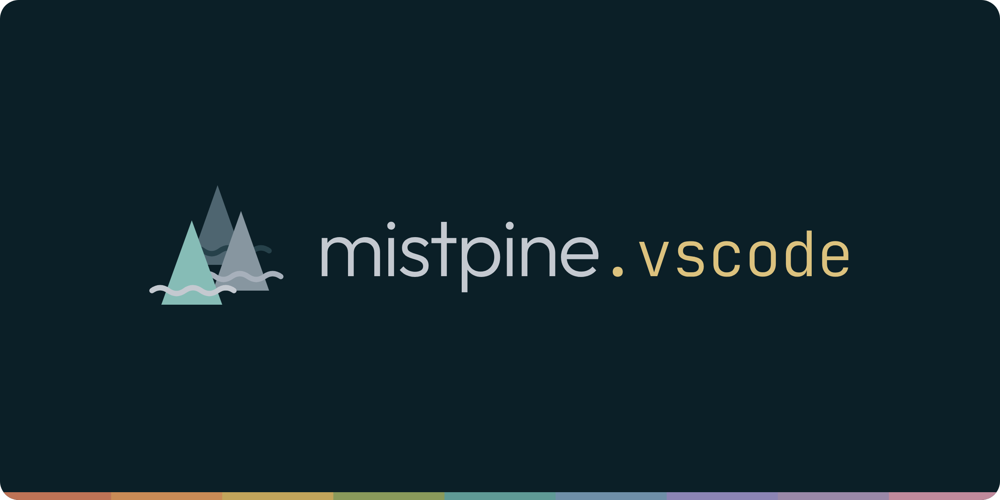
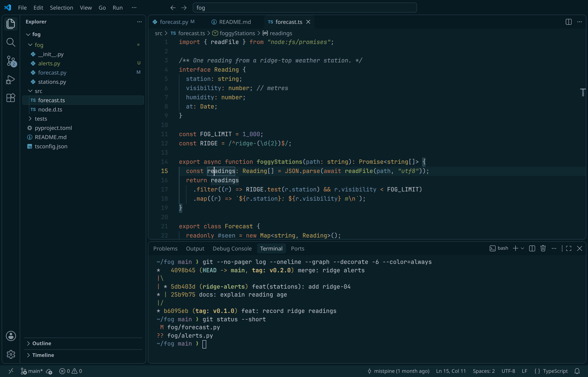
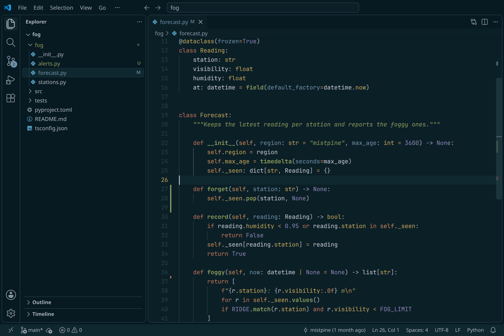
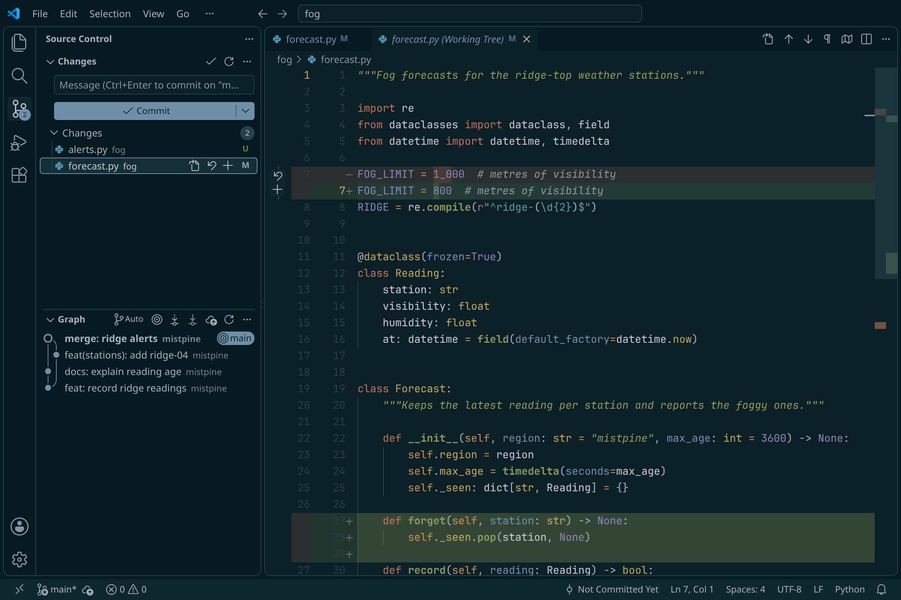
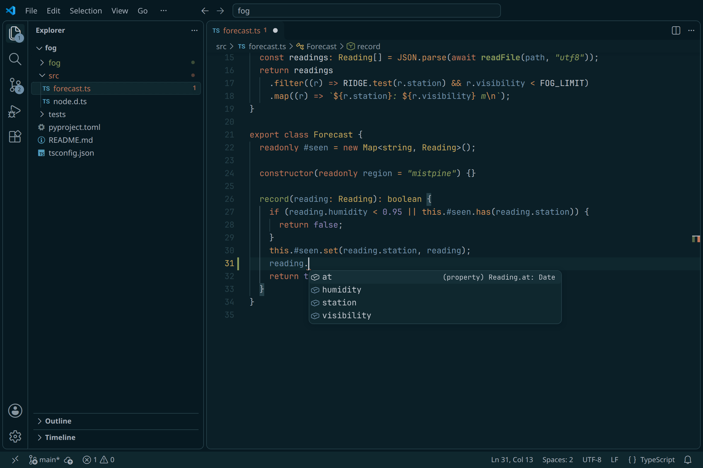
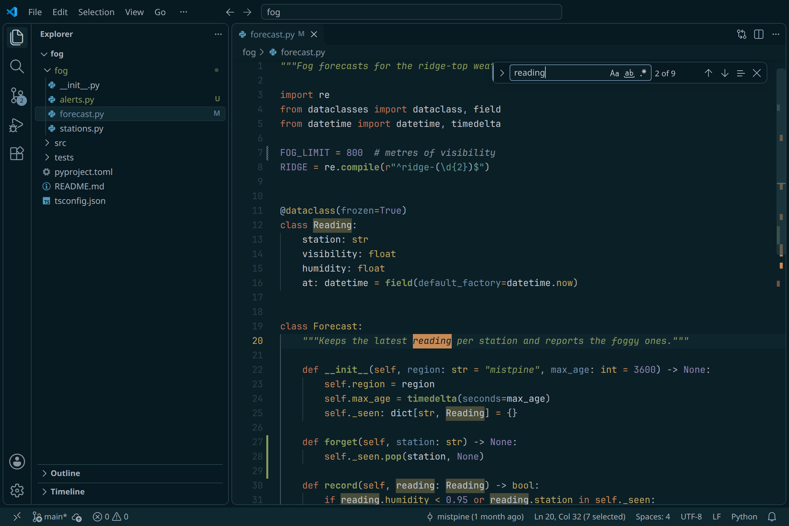
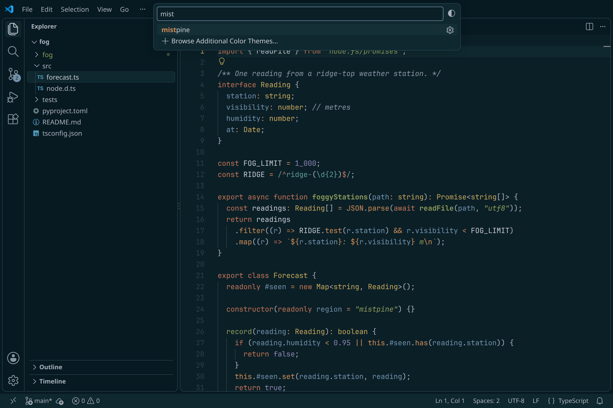
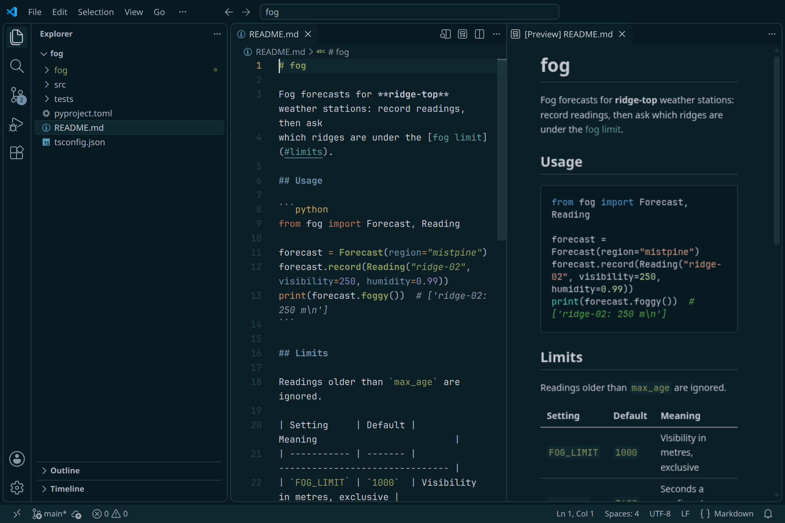
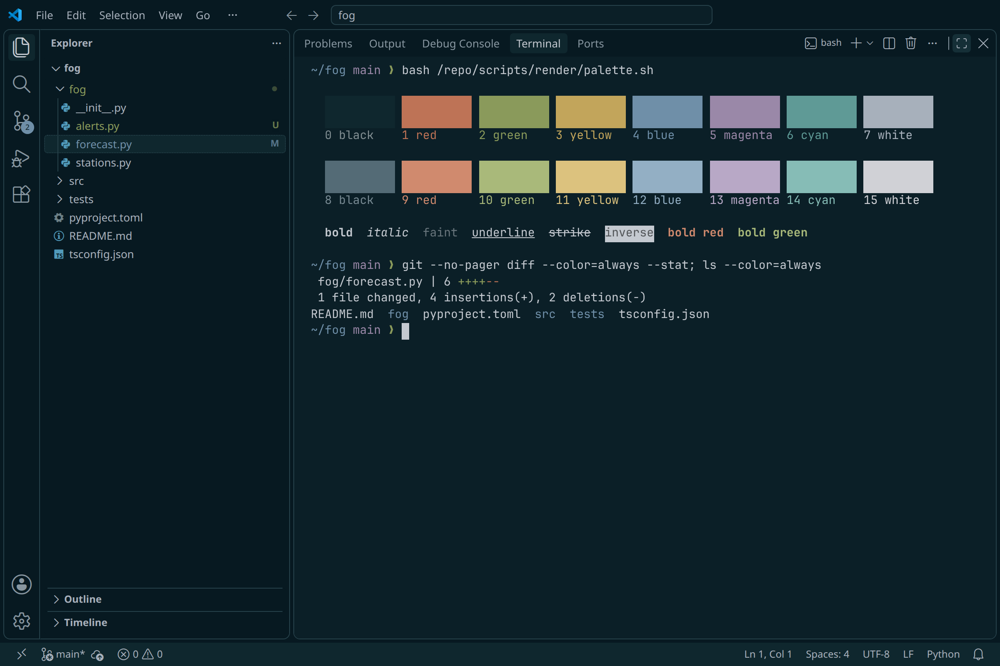
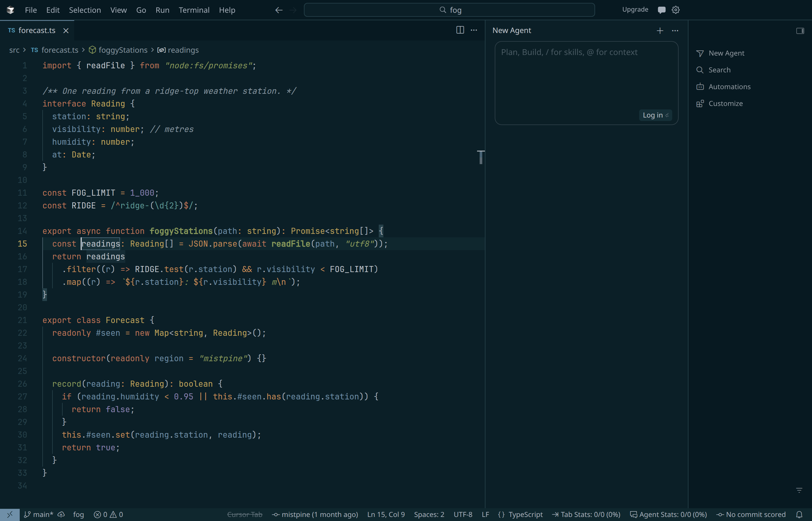

<p align="center">
  
</p>

<p align="center">
  
</p>

**mistpine** for VS Code and Cursor: cool, misty grays over a deep blue-green
night, with muted, earthy accents. It is the VS Code port of
[mistpine](https://github.com/mistpine/mistpine) and follows the
[mistpine spec](https://github.com/mistpine/mistpine/blob/main/docs/spec.md):
every color is a palette color or one of the spec's blends, and every syntax
color clears 4.5:1 on the editor background.

- One theme for VS Code, Cursor, VSCodium and other VS Code-based editors
- Side bar, panel and inactive tabs step down to the darkest surface; the
  status bar, menus and the command palette step up
- Syntax by the spec, with semantic highlighting: bold functions, italic
  strings and comments, ochre types, orange builtins and operators
- Diff, search and word highlights are the spec's blends, drawn translucent
  so selections and syntax show through
- The integrated terminal uses the spec's 16 ANSI colors
- Every color VS Code registers is either set or derives from a mistpine
  color: no stray defaults from VS Code's own palette

## Install

**VS Code:** open the Extensions view (<kbd>Ctrl</kbd>+<kbd>Shift</kbd>+<kbd>X</kbd>),
search for **mistpine** and install it, or run:

```sh
code --install-extension mistpine.mistpine
```

**Cursor, VSCodium, Windsurf:** search for **mistpine** in the Extensions
view; these editors install it from [Open VSX](https://open-vsx.org/extension/mistpine/mistpine).

Then pick it: **Preferences: Color Theme** (<kbd>Ctrl</kbd>+<kbd>K</kbd>
<kbd>Ctrl</kbd>+<kbd>T</kbd>) → **mistpine**.

To install by hand, download `mistpine-<version>.vsix` from the
[latest release](https://github.com/mistpine/mistpine.vscode/releases/latest)
and run **Extensions: Install from VSIX…**.

## Customize

Override any color for mistpine alone in your `settings.json`:

```jsonc
{
  "workbench.colorCustomizations": {
    "[mistpine]": {
      // Brackets are punctuation at every depth; give them the accents instead:
      "editorBracketHighlight.foreground1": "#c2a55b",
      "editorBracketHighlight.foreground2": "#8c84b4",
      "editorBracketHighlight.foreground3": "#5f9a96"
    }
  },
  "editor.semanticTokenColorCustomizations": {
    "[mistpine]": {
      // TypeScript marks every `const` readonly; mistpine colors them as
      // variables. To color them as constants:
      "rules": { "variable.readonly": "#8c84b4" }
    }
  }
}
```

Without semantic highlighting (`"editor.semanticHighlighting.enabled": false`)
the theme falls back to TextMate scopes, which color fewer roles.

The Markdown preview highlights code blocks with VS Code's own fixed colors,
which a color theme can't change.

## Screenshots

| | |
| :-: | :-: |
|  |  |
|  |  |
|  |  |
|  |  |

## Development

Requires Node 24+, pnpm (`corepack enable`) and Docker.

The spec loader, color math, banner and pixel checks come from
[@mistpine/port-kit](https://github.com/mistpine/port-kit), shared by every
mistpine port.

```sh
pnpm install
pnpm generate  # themes/mistpine-color-theme.json from src/ and the mistpine spec
pnpm check     # fail if the theme is out of date
pnpm verify    # load the theme in real VS Code and Cursor (Docker)
pnpm render    # the screenshots, from the real apps, with pixel checks (Docker)
pnpm banner    # assets/banner.*, icon.png and the social preview (Chromium)
pnpm package   # mistpine-<version>.vsix
pnpm lint && pnpm typecheck
```

Edit `src/`, never `themes/`. `src/colors.ts` resolves the spec's roles from
[`palette/mistpine.json`](https://github.com/mistpine/mistpine/blob/main/palette/mistpine.json)
(read from `$MISTPINE_DIR`, `../mistpine` or GitHub), `src/workbench.ts`
maps them to VS Code's colors, and `src/tokens.ts` and `src/semantic.ts` to
syntax. `pnpm generate` checks every pair of text and surface colors for
4.5:1, and that each translucent color lands on the spec's blend over the
editor background.

`pnpm verify` runs the theme as a development extension in the VS Code and
Cursor versions pinned in `scripts/lib/app.ts`, asks each for every color it
registers, and fails on colors VS Code doesn't know, colors that don't come
out as set, and colors left to VS Code's own palette. Run
`pnpm verify --audit` after bumping VS Code to list what the new release
added.

`pnpm render` installs the packaged `.vsix` and drives the apps on the
sample repository in `scripts/render/sample`. Cursor opens behind its
sign-in screen; the render hides that screen and shows the editor as it is
when signed out.

To release, bump `version` in `package.json` and add a `CHANGELOG.md` entry,
merge, then push a tag `v<version>`. The release workflow packages the
extension, publishes it to the VS Code Marketplace and Open VSX, and attaches
the `.vsix` to a GitHub release.

## Credits

- Designed in [themes.utimura.io](https://themes.utimura.io).
- [Outfit](https://github.com/Outfitio/Outfit-Fonts) and
  [JetBrains Mono](https://github.com/JetBrains/JetBrainsMono) in the banner.

## License

[MIT](LICENSE).
